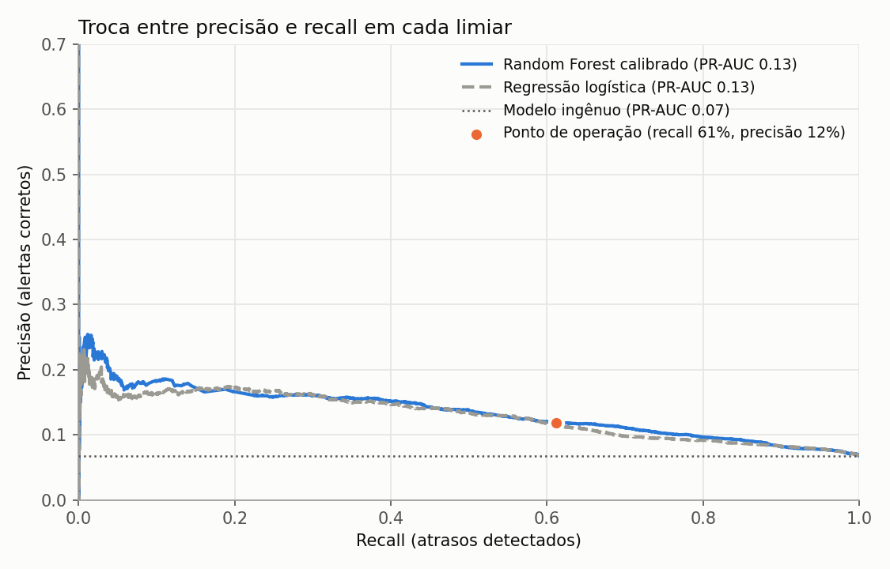
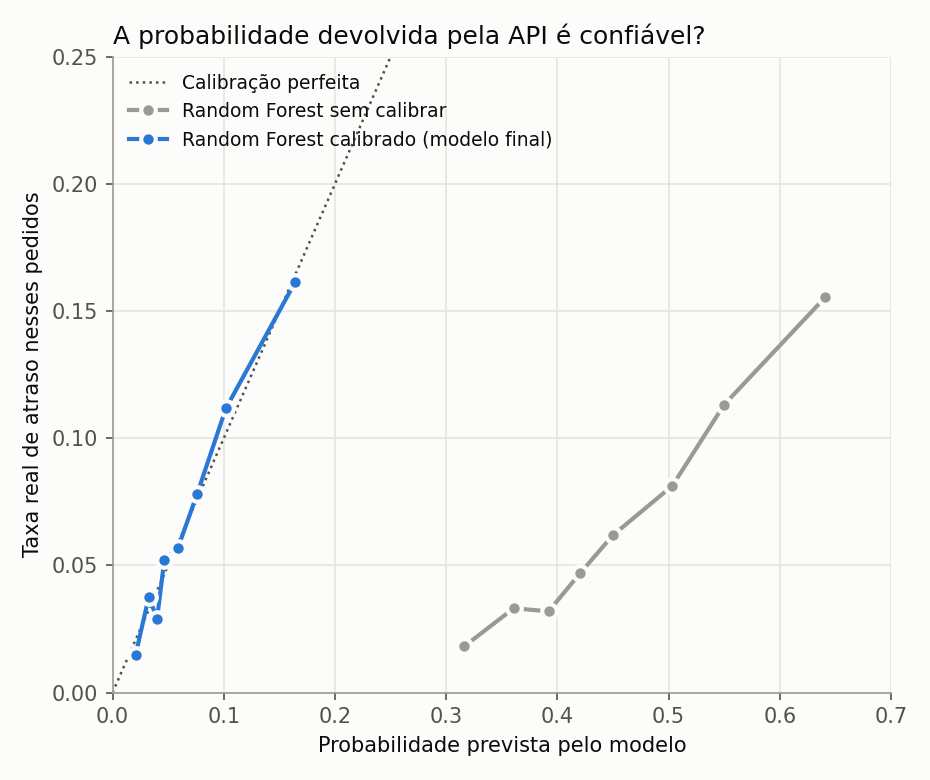

# DeliveryRisk API

**Modelo de previsão de risco de atraso de entregas em produção**  
*Python · FastAPI · scikit-learn · Docker · GCP Cloud Run*

**🔗 Demo ao vivo:** [Testar a API (Swagger)](https://deliveryrisk-api-889571326423.southamerica-east1.run.app/docs)  
*A API fica "dormindo" quando não está em uso: a primeira requisição pode levar alguns segundos.*

---

## Sobre o projeto

Este projeto pega o modelo do projeto [Previsão de Atraso de Entrega](https://github.com/rafaelsimoesdev/previsao-atraso-entregas), o revalida, o recalibra e o coloca no ar como uma API REST documentada, containerizada com Docker e hospedada no Google Cloud Run.

**Problema:** atrasos de entrega são um dos maiores problemas de satisfação no e-commerce. Saber com antecedência quais pedidos têm risco de atraso permite agir antes que o cliente seja impactado.

**Solução:** uma API que recebe os dados do pedido **no momento da compra** e devolve a probabilidade de atraso, o nível de risco (BAIXO, MÉDIO ou ALTO) e se há alerta.

**O que aprendi no caminho:** a validação do projeto original era otimista. Ao testar o modelo "treinando no passado e prevendo o futuro", descobri que o mês da compra, que parecia o fator mais importante, só decorava o calendário de 2017-2018. Removi essa variável e documentei os limites reais do modelo na seção [Validação no tempo](#validação-no-tempo-o-que-mudou-desde-o-modelo-original).

---

## Demo

```bash
curl -X POST "https://deliveryrisk-api-889571326423.southamerica-east1.run.app/predict" \
  -H "Content-Type: application/json" \
  -d '{
    "dia_semana_compra": 4,
    "prazo_prometido_dias": 8,
    "qtd_itens": 2,
    "valor_produtos": 189.90,
    "valor_frete": 35.00,
    "peso_total_g": 800,
    "volume_total_cm3": 4000,
    "estado_cliente": "RJ"
  }'
```

**Resposta:**
```json
{
  "risco_atraso": true,
  "probabilidade_atraso": 0.1569,
  "nivel_risco": "ALTO",
  "mensagem": "🚨 Risco ALTO de atraso: 15,7% de probabilidade, cerca de 2,3x a média (6,8%). Recomenda-se ação preventiva neste pedido."
}
```

Documentação interativa: https://deliveryrisk-api-889571326423.southamerica-east1.run.app/docs

### Como ler a resposta

| Nível | Probabilidade | Alerta (`risco_atraso`) | Na validação |
|---|---|---|---|
| BAIXO | abaixo de 7,1% | `false` | 65% dos pedidos, 4,0% atrasaram |
| MÉDIO | de 7,1% a 13,5% | `true` | 23% dos pedidos, 9,7% atrasaram |
| ALTO | 13,5% ou mais (2x a média) | `true` | 12% dos pedidos, 16,2% atrasaram |

A probabilidade é **calibrada**: 15% significa que cerca de 15% dos pedidos com esse perfil realmente atrasaram. A taxa média de atraso na base é 6,8%.

---

## Stack

| Camada | Tecnologia |
|---|---|
| Modelo | Random Forest calibrado (scikit-learn) |
| API | FastAPI + Pydantic |
| Servidor | Uvicorn (ASGI) |
| Container | Docker |
| Deploy | Google Cloud Run |
| Linguagem | Python 3.11 |

---

## Estrutura do projeto

```
deliveryrisk-api/
├── app/
│   ├── main.py                  # Endpoints da API (/, /health, /predict, /model/info)
│   └── schema.py                # Schemas de entrada e saída (Pydantic)
├── model/
│   └── model.pkl                # Modelo serializado com joblib (+ limiares e metadados)
├── train/
│   ├── treinar_modelo.py        # Treina, calibra, avalia e salva o modelo
│   ├── validacao_temporal.py    # Validação "treinar no passado, testar no futuro"
│   └── requirements-train.txt   # Dependência extra só para os gráficos
├── docs/                        # Gráficos e métricas geradas pelos scripts
├── Dockerfile
├── requirements.txt
└── README.md
```

---

## Endpoints

| Método | Rota | Descrição |
|---|---|---|
| GET | `/` | Status da API |
| GET | `/health` | Health check (Cloud Run) |
| POST | `/predict` | Previsão de risco de atraso |
| GET | `/model/info` | Limiares, métricas e fatores mais importantes |
| GET | `/docs` | Documentação Swagger (automática) |

---

## Avaliação do modelo

O modelo foi treinado com **96.470 pedidos reais** do dataset Olist (e-commerce brasileiro, 2016-2018), usando só informações disponíveis no momento da compra. Apenas **6,8%** dos pedidos atrasam, então a acurácia sozinha engana: um modelo que responde "nunca atrasa" acerta 93,2% e não detecta nenhum atraso. Por isso a comparação usa ROC-AUC e PR-AUC, que não dependem de um limiar.

Resultados em 20% dos pedidos, separados aleatoriamente antes do treino (a mesma divisão do projeto original):

| Modelo | Acurácia | Precisão | Recall | ROC-AUC | PR-AUC |
|---|---|---|---|---|---|
| "Nunca atrasa" (baseline) | 93,2% | 0% | 0% | 0,50 | 0,068 |
| Regressão logística | 66,2% | 11,7% | 60,7% | 0,68 | 0,130 |
| **Random Forest calibrado (em produção)** | 66,7% | 11,9% | 61,2% | **0,69** | **0,135** |

O PR-AUC do baseline é igual à taxa de atraso (0,068). O modelo em produção chega a cerca de **2 vezes** esse valor. Ele empata com a regressão logística: com as informações disponíveis na compra, o sinal é modesto e um modelo mais complexo não muda isso.

### Precisão e recall: a troca em cada limiar



O limiar de alerta (7,1%) foi escolhido para detectar cerca de 6 em cada 10 atrasos, usando **apenas dados de treino** (predições out-of-fold). O custo de um alerta falso é baixo (acompanhar um pedido a mais), e o de um atraso não detectado é a insatisfação do cliente. A contrapartida é a precisão: com esse limiar, cerca de 12% dos alertas são atrasos reais, ou 1,8 vez a taxa média. Mais recall custa mais alertas falsos.

### O que isso significa na operação

Se a operação olhasse só os pedidos de maior risco:

| Pedidos analisados (maior risco) | Atrasos capturados |
|---|---|
| 5% | 13% |
| 10% | 24% |
| 20% | 44% |
| 30% | 56% |

### Por que o modelo é calibrado

O Random Forest com `class_weight="balanced"` infla as probabilidades: pedidos com nota de "45%" atrasavam, na verdade, só cerca de 6% das vezes. Para a API devolver um número que significa o que diz, o modelo foi calibrado (regressão isotônica, validação cruzada). O gráfico mostra o antes e o depois:



### Fatores mais importantes

| Feature | Importância |
|---|---|
| Prazo prometido | 23,0% |
| Valor do frete | 13,5% |
| Estado SP | 11,7% |
| Estado RJ | 10,8% |
| Valor dos produtos | 7,5% |

---

## Validação no tempo: o que mudou desde o modelo original

No projeto original, o **mês da compra** aparecia como o fator mais importante (cerca de 30%). Isso levantou uma suspeita: a base cobre só dois anos, e os atrasos se concentram em episódios específicos (novembro de 2017 e fevereiro-março de 2018). O modelo podia estar decorando esse calendário em vez de aprender algo que se repete.

Para testar, recuperei a data de cada pedido e treinei o modelo **só com o que veio antes** de cada período, testando nele (`train/validacao_temporal.py`):

| Período testado | Atraso real | ROC-AUC com mês | ROC-AUC sem mês |
|---|---|---|---|
| nov/2017 a jan/2018 | 8,6% | 0,65 | 0,64 |
| fev a mar/2018 | 16,6% | 0,67 | 0,68 |
| abr a mai/2018 | 5,5% | 0,65 | 0,69 |
| jun a ago/2018 | 3,6% | 0,56 | 0,51 |

**O que descobri:**
- Na divisão aleatória, o mês acrescentava cerca de 0,06 de ROC-AUC. Ao prever o futuro, esse ganho **desaparece**: ele ajuda em alguns períodos e atrapalha em outros. O mês não generaliza.
- O modelo mantém algum sinal em 3 dos 4 períodos (ROC-AUC de 0,64 a 0,69, sem o mês), mas menos do que a divisão aleatória sugeria (0,75 com o mês, 0,69 sem).
- No último período (jun a ago/2018), o modelo fica próximo do acaso e superestima o risco. Treinando até maio/2018 (atraso de 7,6%) e testando no período seguinte, o modelo previu em média 7,5% de atraso, mas o real foi de apenas 3,5%.

**O que corrigi:** removi o mês da compra do modelo. O modelo em produção e todos os números das seções anteriores usam só as variáveis que sobrevivem ao teste no tempo.

---

## Limitações

- **Sinal modesto.** Com as informações disponíveis na compra (prazo, frete, estado, peso, volume), o modelo prioriza pedidos melhor do que o acaso, mas está longe de prever atrasos com confiança.
- **A taxa de atraso muda no tempo.** Em períodos tranquilos, como o fim da base, o modelo superestima o risco. Em produção seria preciso monitorar e retreinar.
- **Faltam as variáveis que mais explicam atrasos.** O modelo não conhece a transportadora, o vendedor nem a distância real até o cliente.
- **Dois anos de dados.** Sazonalidade (como a Black Friday) não pode ser aprendida com apenas dois ciclos anuais.
- **Dados históricos.** É um projeto de portfólio, não foi validado com pedidos atuais.

---

## Como rodar localmente

### Com Docker (recomendado)

```bash
# Build
docker build -t deliveryrisk-api .

# Run
docker run -p 8080:8080 deliveryrisk-api
```

Acesse: `http://localhost:8080/docs`

### Sem Docker

```bash
pip install -r requirements.txt
uvicorn app.main:app --reload --port 8080
```

---

## Como retreinar o modelo

Use as versões do `requirements.txt` (o `model.pkl` só é garantido nelas). Coloque `base_modelo.csv` na raiz do projeto e rode, da raiz:

```bash
pip install -r requirements.txt -r train/requirements-train.txt
python train/treinar_modelo.py
```

O script salva o `model/model.pkl`, os gráficos e o `docs/metricas.json`. Para a validação temporal, coloque também o `olist_orders_dataset.csv` (original do Kaggle) na raiz e rode `python train/validacao_temporal.py`.

---

## Deploy no GCP Cloud Run

```bash
# Autenticar
gcloud auth login

# Build e push para o Container Registry
gcloud builds submit --tag gcr.io/SEU_PROJETO/deliveryrisk-api

# Deploy
gcloud run deploy deliveryrisk-api \
  --image gcr.io/SEU_PROJETO/deliveryrisk-api \
  --platform managed \
  --region southamerica-east1 \
  --allow-unauthenticated
```

---

## Contexto

Este projeto faz parte de um portfólio de ML com foco em logística e e-commerce:

- **[Dashboard de Logística Olist](https://github.com/rafaelsimoesdev/olist-logistica-powerbi):** análise dos atrasos em Power BI (onde a entrega falha)
- **[Previsão de Demanda Olist](https://github.com/rafaelsimoesdev/previsao-demanda-olist):** previsão do volume diário de pedidos
- **[Previsão de Atraso de Entrega](https://github.com/rafaelsimoesdev/previsao-atraso-entregas):** EDA, pré-processamento e treinamento dos modelos
- **DeliveryRisk API (este repositório):** validação no tempo, calibração e deploy do modelo em produção com FastAPI + Docker + GCP

**Autor:** Rafael Simões — [LinkedIn](https://linkedin.com/in/rafael-sim%C3%B5es-556979239) · [GitHub](https://github.com/rafaelsimoesdev)  
**Dataset:** [Brazilian E-Commerce Public Dataset by Olist](https://www.kaggle.com/datasets/olistbr/brazilian-ecommerce) — Kaggle
